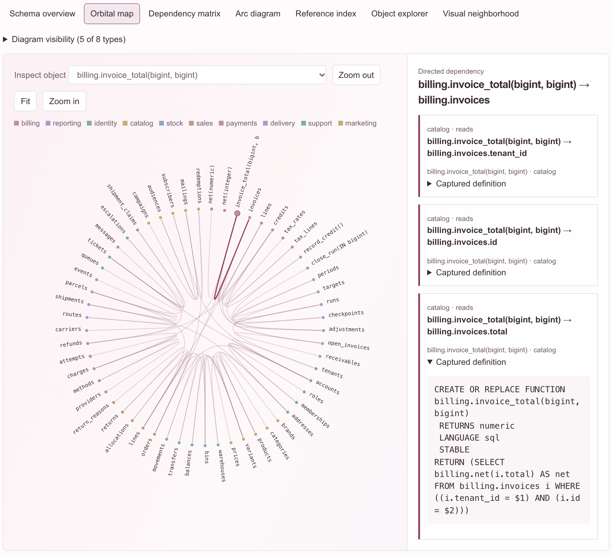

# postgres-viz

Before you rename a PostgreSQL column, find the functions that read it and the views that depend on those functions. Click a reference to see the SQL behind it.

postgres-viz is a standalone CLI with a built-in browser viewer. Scan your database once, then explore or share the resulting `.pgviz.json` file offline.

**[Download the latest release](https://github.com/abaltuta/postgres-viz/releases/latest)** for macOS, Linux, or Windows. The release includes the standalone CLI and packages for VS Code, Zed, and Vim.



## Install

**mise** (macOS, Linux, Windows)

```sh
mise use -g github:abaltuta/postgres-viz@0.10.0
```

**Homebrew** (macOS, Linux)

```sh
brew tap abaltuta/postgres-viz https://github.com/abaltuta/postgres-viz
brew install abaltuta/postgres-viz/postgres-viz
```

**Scoop** (Windows)

```powershell
scoop bucket add postgres-viz https://github.com/abaltuta/postgres-viz
scoop install postgres-viz/postgres-viz
```

## 60-second demo

After installing, run the bundled ten-schema commerce example. The demo works offline.

```sh
postgres-viz demo
```

1. Open **Object explorer**, search for `billing.invoices.total`, and select **total**.
2. Choose **Referenced by** and **2 hops**. Find the path through `billing.invoice_total(bigint, bigint)` to `reporting.open_invoices`.
3. Select the reporting view on that path. The first SQL definition shows where the function reads the column. The second shows where the view calls the function.

Switch to **Visual neighborhood** to see those connections side by side, or **Orbital map** for the whole database. Press Ctrl-C in the terminal to stop the viewer.

## Scan a PostgreSQL database

Pass a connection URI to open your database in the viewer. If you already set `DATABASE_URL`, run `postgres-viz` on its own.

```sh
postgres-viz 'postgresql://user@host:5432/database'
```

Use `scan` to save a snapshot and `open` to read it later.

```sh
postgres-viz scan 'postgresql://user@host:5432/database' --out database.pgviz.json
postgres-viz open database.pgviz.json
```

The default scan covers all eligible schemas. Repeat `--schema NAME` to select schemas or `--exclude-schema NAME` to skip them. Use `--no-fks` to omit foreign-key links. If a scan fails, your previous snapshot is preserved.

## Share and query offline

Send the snapshot to a teammate. They can open it with the CLI or VS Code without a database login. The CLI serves the viewer on localhost. To print its URL without launching a browser, run `postgres-viz open database.pgviz.json --no-browser`.

The file omits the connection URI but includes object names, SQL definitions, snippets and diagnostics. Review SQL literals and comments before sharing.

You can also trace references from the terminal. From this checkout, try the same two-hop search as the demo.

```sh
postgres-viz refs --file examples/commerce/commerce.pgviz.json --column billing.invoices.total --depth 2
```

Use `--json` for machine-readable output. For mixed-case or spaced names, pass one shell argument with each SQL identifier quoted, such as `'billing."Invoice Lines"."Total"'`.

## How the parser works

In the bundled ledger example, the function `ledger.account_deltas` reads `ledger.entries.account_id`, even though its SQL calls the column `owner`.

```sql
FROM ledger.accounts AS a
CROSS JOIN LATERAL (
  SELECT sum(e.amount) AS amount
  FROM ledger.entries AS e(owner)
  WHERE e.owner = a.id
) AS calc
```

**From SQL to column IDs.** The scan reads the catalog in a read-only, repeatable-read transaction. That gives the analyzer each table's columns in order, alongside dependencies PostgreSQL already tracks in `pg_depend`. A child process parses the function body into a syntax tree. The `RangeVar` node for `ledger.entries` carries the table alias `e` and the column alias list `(owner)`. The analyzer builds an ordered list of visible names paired with their source column IDs. Applying `(owner)` to the first entry preserves the ID of `account_id` and leaves `amount` untouched.

**Resolving the predicate.** The tree represents `e.owner` and `a.id` as separate `ColumnRef` nodes. The first resolves inside the subquery. Because the subquery is `LATERAL`, its scope also includes the preceding `FROM` item, so `a.id` resolves to `ledger.accounts.id`. Each resolved read becomes a relationship with a SQL snippet. When the parser can locate the fragment uniquely in the captured definition, it also saves the character range the viewer can highlight.

**Following the caller.** For PL/pgSQL, the analyzer walks the procedural tree and parses the SQL inside it. In `ledger.post_deltas`, the query inside a `FOR` loop calls `ledger.account_deltas`. Following that call and the column read backwards gives the two-hop path from `account_id` to the procedure. Literal `EXECUTE` strings can be parsed the same way. When the procedure constructs a table name from an argument, the snapshot records an unresolved reference. [Routine definitions](examples/routines/schema.sql) · [Scope resolution](internal/analysis/scope.go)

```sh
postgres-viz refs --file examples/routines/routines.pgviz.json --column ledger.entries.account_id --depth 2
```

## PostgreSQL parser coverage

postgres-viz supports PostgreSQL 16 through 19. It uses the PostgreSQL 17 grammar with targeted extensions for newer syntax. A dash means the server version has no such syntax.

| What the analyzer can trace | PG 16 | PG 17 | PG 18 | PG 19 |
| --- | :---: | :---: | :---: | :---: |
| Source columns through table aliases, joins, CTEs, correlated subqueries and `LATERAL` | Yes | Yes | Yes | Yes |
| Read and write targets in `INSERT`, `UPDATE`, `DELETE` and `MERGE` | Yes | Yes | Yes | Yes |
| Routine calls with positional or named arguments, defaults and variadic arguments, when the target is unambiguous | Yes | Yes | Yes | Yes |
| PL/pgSQL embedded queries, `%ROWTYPE` field references and trigger `OLD` / `NEW` fields | Yes | Yes | Yes | Yes |
| SQL in a literal PL/pgSQL `EXECUTE` string | Yes | Yes | Yes | Yes |
| Source columns read by `JSON_TABLE`, such as the JSON payload column | - | Yes | Yes | Yes |
| Column reads in a `MERGE ... RETURNING` list | - | Yes | Yes | Yes |
| Old and new target-row columns in DML `RETURNING`, including `WITH (OLD AS ..., NEW AS ...)` aliases | - | - | Yes | Yes |
| Conflict-target, predicate and returned-column reads in `INSERT ... ON CONFLICT (...) DO SELECT ... RETURNING` | - | - | - | Yes |

The catalog also supplies dependencies for views, materialized views, indexes and constraints. A view's call to a function may be recorded for the whole view. Check the endpoint before attributing the call to an output column.

On PostgreSQL 18 and 19, snapshots also include virtual generated-column dependencies, additional `NOT NULL` constraint objects and foreign-key details such as `PERIOD` and `NOT ENFORCED`. [Parser tests](internal/analysis) · [Live PostgreSQL fixtures](internal/integration/version_features_test.go)

## Examples

| Saved example | What to follow |
| --- | --- |
| [Commerce](examples/commerce/commerce.pgviz.json) | The invoice total, its generated balance, the partial expression index and the reporting view across a 50-table database. |
| [Simple ledger](examples/simple/simple.pgviz.json) | One table, one function and one view isolate a two-hop dependency. |
| [Ledger functions and procedures](examples/routines/routines.pgviz.json) | Follow `ledger.entries.account_id` to `ledger.post_deltas`. Compare its literal and runtime-built `EXECUTE` commands in the [routine definitions](examples/routines/schema.sql). |

## Editors

- **VS Code**. Install the VSIX for your platform, then open a `.pgviz.json` file. To scan a live database, run **postgres-viz: Capture Database Snapshot**. Select evidence to open the matching workspace source or captured SQL. [VS Code setup](editors/vscode)
- **Zed**. Extract the Zed ZIP and use **zed: install dev extension** on the folder containing `extension.toml`. Browse a snapshot in the outline, or launch the viewer from the task picker with `postgres-viz` on your PATH. [Zed setup and tasks](editors/zed/README.md)
- **Vim**. Install the plugin and put `postgres-viz` on Vim's PATH. Open a snapshot and run `:PostgresVizOpen`. To capture one, set `DATABASE_URL` and run `:PostgresVizScan database.pgviz.json`. Requires Vim with job support. [Vim setup](editors/vim/README.md)

## Development

For issue reports and pull requests, see the [contribution guide](collaboration.md).

Use the Go version pinned in [mise.toml](mise.toml), Node.js 22.16 or newer, and the pnpm version pinned in [package.json](package.json). Run the following from the repository root on macOS or Linux.

```sh
mise install
mise exec -- pnpm install --frozen-lockfile
mise exec -- pnpm build
./dist/postgres-viz demo
```

Run the local checks with the pinned toolchain active.

| Check | Command |
| --- | --- |
| Types, lint and smoke tests | `pnpm typecheck`, `pnpm lint`, `pnpm smoke` |
| Browser interactions | After building, set `CHROME_BIN` to your Chrome or Chromium executable and run `pnpm test:ui`. |
| Live database fixtures | `pnpm test:db` starts PostgreSQL 16 in Docker. Set `PGVIZ_POSTGRES_MAJOR` for 17, 18 or 19, or point `DATABASE_URL` at a disposable server where the test role can create databases. |

See the [maintainer guide](maintainers.md) for releases and fixture updates.

## License

postgres-viz is distributed under the [MIT License](LICENSE).
